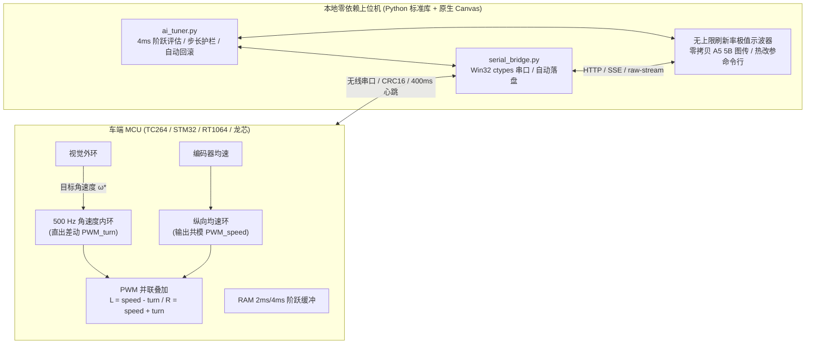

# TC264-TunePro · 智能车无线实时调参上位机与 AI 闭环整定台

> 面向差速视觉与嵌入式智能车打造的零依赖本地调参仪器：纯 Python 标准库 + 原生 HTML/JS/Canvas，免 `pip install`、免前端构建，支持 **两串一并（2S1P）/ 传统三串** 双拓扑切换、零拷贝无线压缩图传、4 ms 板载阶跃定量分析与带硬护栏的 AI 闭环 PID 自动整定。

[](https://github.com/Luok1xi/TunePro/releases)
[](#在线简易演示)
[](#快速开始)
[](LICENSE)

---

## 在线简易演示

无需连接实体小车，也无需安装 Python，仓库提供两种零门槛体验方式：

1. 🌐 **浏览器轻量交互演示（零安装）**：打开 [`demo/index.html`](demo/index.html)（开启 GitHub Pages 后直达 [`https://luok1xi.github.io/TunePro/demo/`](https://luok1xi.github.io/TunePro/demo/)）
   - 在浏览器里实时切换 **2S1P / 传统三串** 控制拓扑；
   - 拖动 `Kp / Ki / Kff` 滑条实时观察模拟陀螺阶跃响应、**10→90% 上升时间、超调量与差模 PWM 饱和告警**；
   - 体验 **AI 安全步长单步整定与恶化自动回滚**、无线 RLE 相机中线预览以及 `Esc` 一键急停。
2. 🖥️ **完整本地离线虚拟小车（`MOCK0`）**：克隆仓库后双击 [`启动离线演示.bat`](启动离线演示.bat) 或运行 `python app.py --demo`，即可完整体验真实串口桥、双拓扑全部视图、自动落盘 `./runs/` 与 AI 调参工作台。

---

## 为什么做这个工具

调车时用普通串口助手和通用波形软件，最消耗时间的是四件事：改一组 PID 就得停车重来；115200 无线串口很难同时兼顾控制遥测和摄像头图传；把控制架构升级为「两串一并（2S1P）」后，角速度环直出差动 PWM，原有软件既对不上滑条量程也看不清弯道里究竟是纵向还是转向先顶满；跑完一趟阶跃波形一闪而过，缺少精准的上升时间、超调与历史曲线叠加对照。

**TC264-TunePro** 把这些痛点整理为一套协议与芯片解耦、即开即用的开源上位机。

---

## 控制拓扑与数据链路



---

## 核心功能

### 1. 「两串一并（2S1P）」与「传统三串」双拓扑实时切换
- **两串一并（2S1P）**：提供同步均速 `Kp / Ki` 滑条（排查单轮硬件时可展开独立微调）、角速度直出 PWM 宽量程滑条（`Kff 0~6.0`、`Kp 0~40.0`、`Ki 0~2.0`）及「开负压 / 干地」常用预设；内置 **共模 / 差模 PWM 视图**，无需改动车端 `@M2` 遥测包即可直接解算 `PWM_speed = (pwmL+pwmR)/2` 与 `PWM_turn = (pwmR-pwmL)/2`。
- **传统三串**：保留「视觉外环 → 角速度中环 → 左右独立轮速 PI」完整量程与单轮阶跃整定流程。

### 2. 不停车热改参 + 快捷命令行
- 持续运转时直接切换目标与参数，滑条和 `±` 微调按 **80 ms 节流合并** 发送；角速度环支持 `+300 ↔ -300 °/s` 原地正反切换，避开静摩擦死区观测陀螺滞后；外环 `Kp / Kd` 支持同步写入当前直道速 `±20` 区间（`#D`），消除换挡跳变。
- 顶部命令行支持方向键翻历史与简写操控：`B 140` / `L 120` / `R 150`（运转）、`W -300`（原地角速度）、`vkp 38` / `ykp 18` / `yff 1.85` / `fan 40`（热改参）、`s` 或 `0`（优先急停）。

### 3. 零 GC 极值示波器、零拷贝无线图传与 4 ms 板载阶跃分析
- **极值包络示波器**：5 套预设视图，渲染帧率跟随显示器原生刷新率无上限，预分配零 GC 缓冲区，每像素列保留最大最小值不丢超调尖峰；自动计算 RMS 跟踪误差、互相关滞后（ms）、穿越次数与 PWM 饱和占比。
- **零拷贝无线压缩图传**：本地桥接通过 `/api/serial/raw-stream` + `TCP_NODELAY` 直推原生二进制流跳过 Base64/JSON 编解码；支持 `A5 5B` 分片 CRC16 协议（`188×120` 二值 RLE、`94×60` 4-bit 灰度、`47×30` 8-bit 灰度）及逐飞助手 `AA 02` 图像流，画面叠画中线、加权带与偏差位置并可存 PNG。
- **板载高清阶跃示波器**：停车后一键拉取车端 RAM 里的 2 ms / 4 ms 记录；多阶阶跃自动跳过第一段静摩擦沿，定量计算 **10→90% 上升时间、超调百分比、平台均值/峰峰值与振荡次数**，支持上一趟虚线对照与 CSV / 汇总 PNG 导出。

### 4. AI 调参搭档与外部 Coding Agent Skill
- **离线即用 + 多模型支持**：内置「循证规则整定器」，无需 API Key 即可离线对话并闭环调参；支持直连本机官方 CLI（Claude Code / Codex / Antigravity / Gemini）、OpenAI 兼容接口、Ollama 本地模型与 Claude，密钥只驻留内存不落盘。
- **硬护栏与自动回滚**：每轮自动发 `#X GO` → 拉取 4 ms 波形评估 → 经参数限幅与单轮最大步长（`max_step`）检查后写入并回读 `@GP1` 核验；一旦性能退化或振荡加剧，自动回滚至历史最佳稳定参数。
- **外部 Agent Skill**：内置 [`skills/tc264-pid-tuner/`](skills/tc264-pid-tuner/SKILL.md)（零依赖 Python CLI + 控制环路语义文档），支持任意 Coding Agent 经本地 HTTP API 读快照、跑阶跃、限幅改参与离线分析 `./runs/*/m2-decoded.csv`。

### 5. 安全机制与自动落盘
- **双层防误发车锁**：连真实 COM 口默认锁定自动发车与写参，需勾选解锁与「已架空车轮 / 3S ≥ 11.7V」，急停或断联自动复位上锁；2S1P 另提供干地限幅开关（`ykp ≤ 14`）。
- **无阻塞急停与心跳看门狗**：任意时刻按 `Esc` / `Space` 直发 `#!` + `#X STOP`；远程运行期间每 `400 ms` 发送 `#X PING` 心跳，断联自动停车；所有写参带 **CRC-16/CCITT-FALSE** 与 `rev` 版本号校验。
- **全自动归档**：每趟发车至停车自动把原始 `@M2`、解码 `m2-decoded.csv` 和 `summary.json` 存入 `./runs/`。

---

## 快速开始

- **Windows 免装 Python**：在 [GitHub Releases](https://github.com/Luok1xi/TunePro/releases) 直接下载单文件 `TunePro-Windows-x64.exe` 双击运行。
- **源码运行（仅需 Python 3.10+）**：Windows 通过 `ctypes` 原生调用 Win32 API 读写串口，免装 `pyserial`（Linux / macOS 连实车按需安装 `pyserial`）。

```bash
# 启动内置虚拟小车 MOCK0 完整离线演示
python app.py --demo

# 启动连接真实小车（默认监听 http://127.0.0.1:18760）
python app.py

# 运行 21 项 Python 单元测试与前端协议测试
python -m unittest discover -s tests -p "test_*.py" -v
node --test tests/test_tunepro.mjs
```

完整指令格式、CRC-16 C 代码与压缩图传协议见 [`docs/PROTOCOL.md`](docs/PROTOCOL.md)，协议不绑定特定单片机型号，TC264 / STM32 / RT1064 / 龙芯均可对接。

---

## 许可与致谢

- 本项目遵循 [GPL-3.0](LICENSE) 开源许可。
- AI 循证实验闭环、步长护栏与回滚方法借鉴自 [KINGSTON-115/llm-pid-tuner](https://github.com/KINGSTON-115/llm-pid-tuner)（MIT License），详见 [`THIRD_PARTY_NOTICES.md`](THIRD_PARTY_NOTICES.md)。
